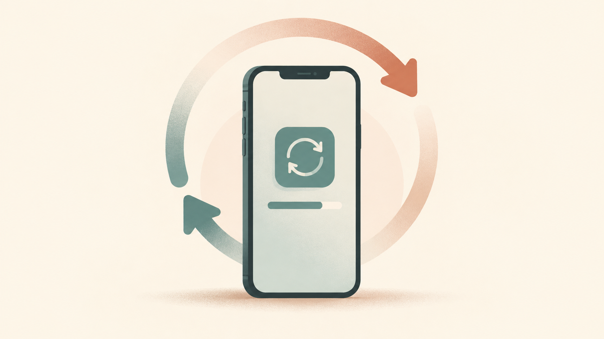

# Android app updates without the APK hunt

Research note, checked 16 Nov 2026 against current Android, Play Console and F-Droid documentation. Written for personal or side-loaded apps, where there is no store operations team and every update so far meant downloading an APK and tapping through the install screen by hand.

Every route ends at the same place: Android installs a new APK over the old one. What differs is who downloads it, how many taps it costs, and whether the signing key survives.

## The rules that decide every route

1. **Android treats the signing key as part of the app's identity.** An update normally needs the same package name, a higher version code, and a matching signature; then it installs over the old version and keeps its data. A signature that matches neither the installed key nor a valid v3 rotation lineage is refused (`INSTALL_FAILED_UPDATE_INCOMPATIBLE`), and the usual way forward is uninstalling first. Two escape hatches exist, both easier before disaster: a v3 rotation lineage, created while the old key still exists (see below), and Play App Signing, where Google holds the app signing key and a lost upload key can be reset. Without either, a lost key means losing the ability to update the app at all.
2. **Prompt-free updates are conditional, not automatic.** Since Android 12 an installer can update an app without showing the install screen only when every condition holds: it sets `USER_ACTION_NOT_REQUIRED`, the app being updated targets a recent API level (API 29+ on Android 12, 30+ on 13, 31+ on 14, 33+ on 15, 34+ on 16, 35+ on Android 17), the installer is the app's installer of record or update owner, or the app is updating itself, and the installer declares the `UPDATE_PACKAGES_WITHOUT_USER_ACTION` permission. Anything missing brings back the one-tap install screen. The target-API requirement keeps advancing and Android always keeps the right to prompt (the official docs tell apps to expect `STATUS_PENDING_USER_ACTION`), so every route must handle a prompt gracefully; "zero taps" below always means the normal case under these conditions, not a guarantee.
3. **What an uninstall costs is per-app.** Check the app's own backup settings before treating a reinstall as cheap: an app that disables Android backup and device transfer and has no export feature loses everything it stored when it is uninstalled. An app that only caches remote data costs a re-setup, not data.
4. **No route removes the first manual step.** The very first install of an app, plus the one-time "allow installs from this source" grant in the normal sideload flow, always happen by hand. The grant can be revoked any time in Settings.

## The five routes compared

1. **Updater inside the app.** Prompt-free in the normal case once built in: an app updating itself satisfies the self-update condition above, and no new accounts are needed. Setup: updater code in the app plus a build source it can fetch. Catch: it has to be built and maintained, and the signing key must be kept safe for the app's whole life. If new builds live anywhere private, the fetch route must not leak a credential - baking a token into an APK (especially one with public source) hands it to everyone, so private delivery has to be solved first.
2. **Obtainium.** Prompt-free in the normal case after its first update of each app. A free app, installed from GitHub or F-Droid, no new accounts. It is built around watching public release pages such as GitHub releases. Setup: install it and add the app's release URL. Catch: normally one prompted update before it takes over as installer of record.
3. **Own F-Droid repo.** Prompt-free in the normal case after the first update, no new accounts, but you run the repository. F-Droid client 1.19 added unattended updates on Android 12+ for everyone, no root needed. Self-hosted F-Droid repos are typically set up as public HTTP repositories, so check what your hosting exposes before pointing one at builds you consider private. Catch: a whole repository for a handful of personal apps.
4. **Google Play tracks.** Prompt-free in the normal case: Play auto-updates. Needs a Google developer account ($25 one-time registration with identity verification). Two gates are easy to confuse: the internal track reaches only testers you list and has no tester-count requirement, while personal accounts created after 13 Nov 2023 must additionally run a closed test with at least 12 testers opted in continuously for 14 days before they can apply for production access. Catch: Google's rules apply to personal apps too. Moving an existing sideloaded app to Play does not force a reinstall if you still hold its signing key: Play App Signing enrollment for existing apps lets you transfer a copy of your original key with the PEPK tool. For an ordinary sideloaded app with no Play enrollment and no usable rotation lineage, a lost original key is what forces the uninstall-and-reinstall path.
5. **Manual APK.** Download plus install screen, every release. No accounts and zero setup; no app store is needed. Distribution privacy depends on where the APK is hosted and who can fetch it. Catch: the APK hunt every release, which is the thing this note exists to escape.

Why "after its first update": Android skips the prompt only for the installer that put the app there (the installer of record or update owner), or for an app updating itself. So a new installer normally shows the usual install screen once - the F-Droid project describes its unattended updates the same way, working "after the first install or first update" - and then owns future updates, subject to the eligibility conditions in rule 2.

## The escape hatch when a key is about to be lost

A v3 signature rotation lineage lets a new key update an installed build in place, but it can only be created while the old key still exists: `apksigner rotate` needs both keys. Builds then carry the new key plus the lineage, and Android 13 (API 33) or later installs them as normal updates. Google explicitly recommends against relying on key rotation on Android 12 (API 31) and earlier, so this path depends on the device's Android version. For an app distributed by sideloading, with no Play App Signing enrollment and no other retained signing path, once the old key is gone that door is shut and the next update costs an uninstall.

The durable takeaways are boring: keep one signing key per app, keep it backed up somewhere that outlives any single machine, and decide the update route before the first install, because the cheapest moment to set it up is before there is data to lose.

## What still needs a tap, whatever you pick

- The very first install of each app, plus the one-time "install unknown apps" permission for whatever installs or updates it.
- Normally, the first update handled by any new installer: it must own one prompted update before Android lets it work quietly, when the rule-2 conditions are met at all.
- Play Protect may scan sideloaded APKs and occasionally asks for confirmation.
- Android can always fall back to the install screen, so every route needs to handle a prompt gracefully.

## Where this lands

For a personal app with public source builds, a small self-updater inside the app plus one durably stored signing key is a strong fit: no new accounts, no stores, updates that arrive by themselves when the eligibility conditions hold. Obtainium is a solid no-code fallback for public builds. Google Play removes the manual work too, but not the overhead: a $25 fee, identity verification, the closed-test gate before production access for new personal accounts, and ongoing policy obligations. Whichever route wins, the signing key's safety is the part that cannot be rebuilt later.

## Sources

- [Android Developers: PackageInstaller user-action conditions](https://developer.android.com/reference/android/content/pm/PackageInstaller.SessionParams#setRequireUserAction(int))
- [Android Developers: Sign your app (key loss and Play App Signing)](https://developer.android.com/studio/publish/app-signing)
- [AOSP: APK signature scheme v3 and key rotation](https://source.android.com/docs/security/features/apksigning/v3) · [Android Developers: apksigner](https://developer.android.com/tools/apksigner)
- [Play Console Help: use Play App Signing (existing-app enrollment via PEPK)](https://support.google.com/googleplay/android-developer/answer/9842756?hl=en)
- [Play Console Help: testing requirements for personal accounts](https://support.google.com/googleplay/android-developer/answer/14151465?hl=en) · [Play Console Help: $25 registration and verification](https://support.google.com/googleplay/android-developer/answer/14659200?hl=en)
- [F-Droid: unattended updates on Android 12+](https://f-droid.org/2024/02/08/twif.html) · [Obtainium on GitHub](https://github.com/ImranR98/Obtainium)

## Illustration

*Illustration created for this app-update comparison; it is not an installed-build screenshot or evidence that an update route was tested on a device.*
