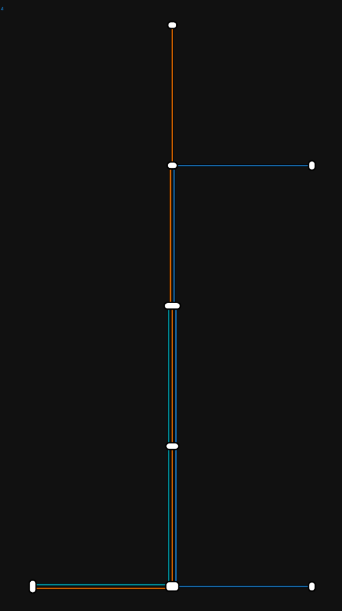

# Automatic layout for transit-style maps (research for Tuju and future maps)

Checked 2026-11-23. Tuju is the case that prompted this note. Tuju's layout fix is a separate, ongoing piece of work. Updated 2026-11-23: the two open questions below are now settled as design requirements (see the last section). Updated later the same day: items 1 to 3 of the recommended path are now built as small developer tools in the Tuju repository. The drawn map is unchanged (byte-identical SVG); the routing and packing tools are not applied to the live map; LOOM stays parked.

## What the map needs

From the feedback on Tuju 0.2.8 and the follow-ups, the layout has to do eight things at once:

1. Keep parallel lines apart (spacing), including walking links beside route lines.
2. Cross as few times as possible, and mark the crossings that remain.
3. Use few bends (no needless turns).
4. Keep every line clear of every piece of text, including multi-line notes.
5. Use the page well (less empty space, less scrolling).
6. Keep the real connections: layout may move things, never change which stop joins which.
7. Draw outbound and return as one shared spine with the two directions on opposite sides where the real stop locations support it, and as separate branches only where they actually differ. Stops are merged only after their coordinates are checked, so two different boarding points are never drawn as one stop.
8. Grow tall, not wide: a portrait map that scrolls down reads better on a phone than a wide one.

Three design requirements frame all eight. First, Tuju is a personal schematic: it is built for one rider, anchored at a chosen starting point, and covers the routes actually ridden from there rather than the whole city network, so geographic fidelity is not a goal in itself. Second, real stop coordinates are a tool for identity and access questions, not a general layout rule: whether two stops are the same station, the same bridge stop on opposite sides of a big road, which side of the road a stop is on when a footbridge is involved and whether it sits before or after the bridge, and which stop is nearer the destination. Nearby stops are never interchangeable on distance alone. The reverse limit also holds: proximity is not walkability. Especially between cities, big roads sometimes have no crossing or footbridge, so two stops can sit close in coordinates and still not connect on foot. Coordinates alone cannot prove a safe or legal crossing; unknown pedestrian access stays marked as unknown, never drawn as a usable walk. Third, the reference look for shared stretches comes from TransJakarta's own route diagrams (for example corridor S11): two close parallel direction lines, each direction keeping its own stop marks and its own names on the outside, including stops named as the opposite of another stop. The result stays narrow and never implies that stops facing each other are the same boarding point.

Today the Tuju generator (`tools/build_route_map.py`) places each column by hand with fixed x/y values and label offsets, then tests check some geometry afterwards. Every fix is a manual nudge, and a nudge for one problem tends to create another. The extracted data (`data/route-stops.json`) holds stop id, name and sequence only, with no coordinates.

## Short answer

No single free tool does all eight. The best fit is to split the job:

- **Shape of the network** (bends, crossings, shared spines): a small purpose-built solver. LOOM/octi is parked for now (see the caveat in option 1).
- **Walking links and text clearance**: obstacle-avoiding connector routing (libavoid), or the same idea in a few dozen lines of grid search.
- **Checks**: automated scoring of crossings, bends, line spacing and line-versus-text overlap, so every change is measured, not eyeballed.

The cheapest first step is the last one, because it works with the current hand-placed generator and gives any future engine a target to beat.

## Options

### 1. LOOM suite (ad-freiburg/loom): best match for crossings, shared spines, bends

- Source: https://github.com/ad-freiburg/loom , GPL-3.0, C++, 317 stars when checked.
- Pipeline of command-line tools reading and writing GeoJSON line graphs: `topo` (merge overlapping lines into one shared segment), `loom` (order the lines inside a shared segment to minimize line crossings), `octi` (turn the graph into a schematic with horizontal, vertical and 45-degree lines), `transitmap -l` (render SVG with labels).
- Papers behind it: Bast, Brosi, Storandt, "Metro Maps on Octilinear Grid Graphs" (EuroVis 2020, https://doi.org/10.1111/cgf.13986) and "Metro Maps on Flexible Base Grids" (SSTD 2021). Only the titles and the README were read, not the papers' full text.
- Why it fits: a shared spine drawn once with several lines side by side is exactly what Tuju's 4/6/7E and 10/7F stretches are, and ordering lines inside a spine to avoid crossings is what `loom` is for.
- **Tested here (small, one-off):** built from source (commit 1e47578, dated 2026-07-24) with cmake and g++, then ran two inputs through `loom | octi | transitmap -l`: the bundled Freiburg example, and a made-up 8-stop, 3-line toy graph with one shared stretch ([toy.json](../site/map-layout/toy.json)). Both finished without errors (about 0.2 s for Freiburg on a 2-core sandbox; one run, not a performance measurement). Renders below. In the toy, the three lines run side by side through the shared stretch and the drawing uses only straight vertical and horizontal segments. In the Freiburg render the shared stretches are bundled, with 45-degree diagonals.

- **Not tested:** Tuju's real network, labels (no station names appear in my two renders, so label behaviour is unknown), and walking links (the tool has no walking-link concept; modelling one as an extra dashed "line" is an untested idea). Real input needs stop coordinates, which means re-reading `stops.txt` from the GTFS feed.
- Fit with the shared-spine preference: treating outbound and return as two lines through the same corridor is what `topo` (merge overlapping segments) and `loom` (order lines side by side) are built for, and merging is decided from coordinates, which matches the "check real stop locations first" rule. Whether `octi` can be steered toward a tall, portrait result was not found in the README and was not tested.
- Caveat: `octi` keeps the map roughly geographic. Tuju's current design deliberately straightens each corridor into its own column, and the geographic octilinear look is not the direction for Tuju. LOOM/octi stays parked unless a future test shows it makes the map less wide and easier to follow than the current hand-built layout; that is the bar for revisiting it.
- License: LOOM is GPL-3.0 (per its GitHub page); Tuju's repository carries the AGPL-3.0 text. Whether and how the two combine was not checked and is unresolved here; running LOOM only as a separate build-time command is a different case from copying its code, but that distinction has not been confirmed against the licence text.

### 2. Mixed-integer programming for metro maps (Nöllenburg and Wolff)

- Paper: "Drawing and Labeling High-Quality Metro Maps by Mixed-Integer Programming", IEEE TVCG 2011, https://pubmed.ncbi.nlm.nih.gov/20498505/ . Only the abstract page was read.
- yWorks wrote up an implementation using this model with a solver (lpsolve, then CPLEX, which was quicker): https://www.yworks.com/blog/automatic-metro-map-generation . Their post says the full algorithm is not in the yFiles library and the linear-programming part depends on third-party software, and yFiles itself is commercial.
- This is the most complete formulation (bends, line length, relative position and labels together), but no ready free implementation was found. Using it would mean writing our own model with a free solver. Untested.

### 3. libavoid (Adaptagrams): for walking links and text clearance

- https://www.adaptagrams.org/documentation/libavoid.html and https://github.com/mjwybrow/adaptagrams . C++ library for "object-avoiding orthogonal and polyline connector routing"; used in Inkscape's connector tool. The page says there are no official releases yet, though the code is described as stable. Licence: LGPL 2.1 or later, per the header of `router.h` and `LICENSE.LGPL` in the repo (https://github.com/mjwybrow/adaptagrams/blob/master/cola/libavoid/router.h). The README also mentions commercial licences.
- Idea: treat every label and note as an obstacle box, route each walking link around the boxes with few bends, and let the router separate parallel segments. This targets the "lines touching text" and "walking link wanders across the map" complaints directly.
- Untested. It is C++, so using it from Tuju's Python build means a wrapper or a small compiled helper.

### 4. ELK (Eclipse Layout Kernel, elkjs)

- https://github.com/kieler/elkjs and https://eclipse.dev/elk/reference/algorithms/org-eclipse-elk-layered.html . JavaScript port of a layered layout algorithm with ports and orthogonal edge routing, built for directed node-link diagrams.
- Fits columns and arrows well, but it lays out graphs where each connection is an edge, not metro lines that share segments, so Tuju's shared spines would need workarounds. Its licence is EPL-2.0; a GitHub issue asks about EPL-2.0 and GPLv3 compatibility (https://github.com/kieler/elkjs/issues/312) and was not resolved here. Untested.

### 5. Others looked at and set aside

- **d3-tube-map** (https://github.com/johnwalley/d3-tube-map , BSD 3-Clause): draws London-style maps, but the coordinates are given by hand, so it does not solve layout.
- **metroflow** (https://github.com/bartromgens/metroflow): interactive map editor on canvas; the README calls it pre-alpha.
- **WebCola** (https://github.com/tgdwyer/WebCola): constraint-based force layout in the browser; useful for non-overlap and alignment constraints, not metro-specific. Untested.
- **OGDF** (https://www.ogdf.uni-osnabrueck.de/license/ , GPL 2 or 3): large C++ graph drawing framework with orthogonal layout; heavy for this job.
- **Graphviz** (`splines=ortho`, https://graphviz.org/docs/attrs/splines/): generic graph layout; no notion of lines sharing a corridor.
- **Transit app's generated maps** (https://blog.transitapp.com/how-we-built-the-worlds-prettiest-auto-generated-transit-maps-12d0c6fa502f/): a good description of a pipeline (shapes, OSM matching, then drawing), but proprietary, so a source of ideas only.

## Recommended path, in order

1. **Measure first (no new dependency): built.** Extend Tuju's existing geometry tests into one score: count of crossings, count of bends, minimum gap between lines of any colour, and any overlap between a line and a text box (using each label's real width, including wrapped notes). Print it for every build. This turns "try to decrease crossings" into a number that must go down. Implemented 2026-11-23 as `tools/score_route_map.py` in the Tuju repository, printed by every map build. One caveat on the numbers: label boxes use an estimated width per character and curves are approximated by short segments, so a score is an estimate for comparing builds, not verified layout quality; a human still checks the rendered map.
2. **Route walking links by search: built as a tool, not applied to the map.** Put all label boxes and route lines on a coarse grid as blocked cells with a margin, then find each walking link with A* that charges for bends and crossings. This is the same idea as libavoid in a small amount of Python and keeps the build dependency-free. Implemented 2026-11-23 as `tools/route_walk_links.py`: unit-tested on synthetic scenes (labels avoided, straight runs preferred, a short detour can beat a crossing), producing orthogonal links in the same style as the hand-drawn walks. It is not wired into the generator and has not routed any link on the live map; adopting it for a specific walk is a separate, per-link step.
3. **Pack columns by search: built as a tool, not applied to the map.** Treat each corridor (outbound and return together where coordinates allow) as a movable block, with a fixed page width and free height, and minimise total link length plus the score above. Pure Python local search is enough at Tuju's size. Implemented 2026-11-23 as `tools/pack_columns.py`: simulated annealing over block positions, unit-tested for overlap-free, in-width, cost-reducing placements. No corridor of the live map has been repacked with it.
4. **LOOM stays parked.** An export-and-run experiment (`topo | loom | octi`) remains worth doing only as a future test of one thing: whether the octilinear result is less wide and easier to follow than the current hand-built layout. It is an option to revisit, not a planned migration; if it does not win, the column layout stays.

Items 1 to 3 are built as developer tools in the Tuju repository, documented in [`tools/LAYOUT_PROPOSALS.md`](https://github.com/irvan-putra/tuju/blob/cedd579ac035c0c852f5e8617884e2763713aca3/tools/LAYOUT_PROPOSALS.md); only the build-time score print is active, and the written map is byte-identical before and after. The walk router and column packer are opt-in tools, not yet applied to or visually proven on the live map. Item 4's tool has been run on example data only and stays parked.

## Open questions: settled 2026-11-23

Both questions that were open when this note was first written are now settled design requirements:

- **Geographic octilinear as the overall style: no.** Tuju is a personal map anchored at a chosen starting point, not a general city transit map, and the current hand-built column layout stays. An octilinear engine may be worth a fresh look in the future, but only if it makes the map less wide and easier to follow than the naive layout in use today; that is the bar for adopting it, an option rather than a guarantee or a mandatory engine choice.
- **Stop coordinates as build input: yes for targeted decisions, not as a general rule.** Experience with transit maps says real coordinates break down when used as a general layout rule. They are the right tool for deciding whether two stops are the same station, the same bridge stop on opposite sides of a big road, and footbridge access: which side of the road a stop is on, whether it sits before or after the footbridge, and which stop is nearer the destination. That also settles the second open question: the public GTFS feed's stop coordinates are useful build input for exactly these checks. The reverse limit holds too: coordinates cannot prove a walk. Where a big road has no crossing or footbridge, stops that are close in coordinates may be unusable as a pedestrian connection, so unknown access is marked unknown rather than drawn as a usable walk.
