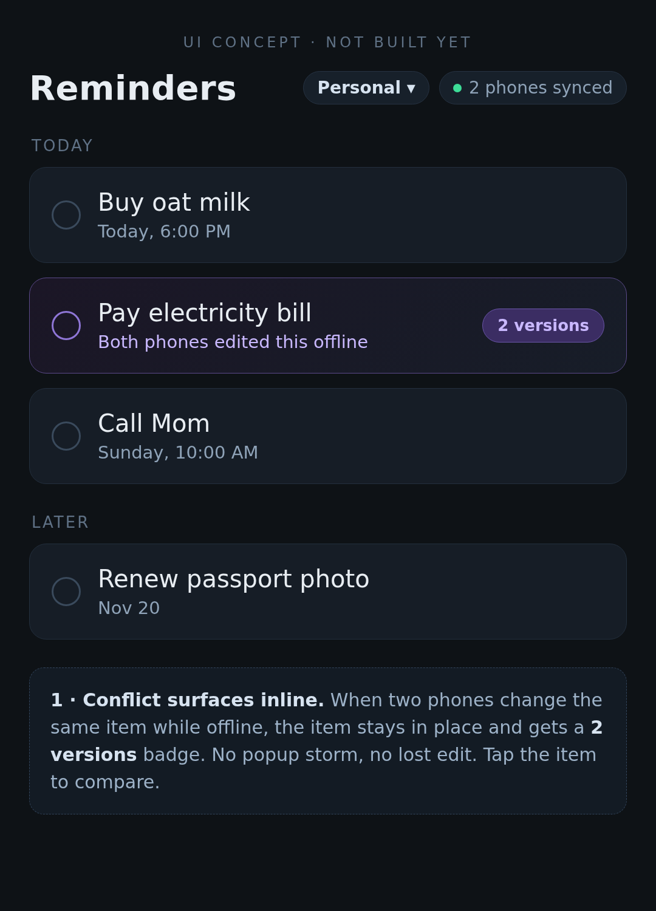
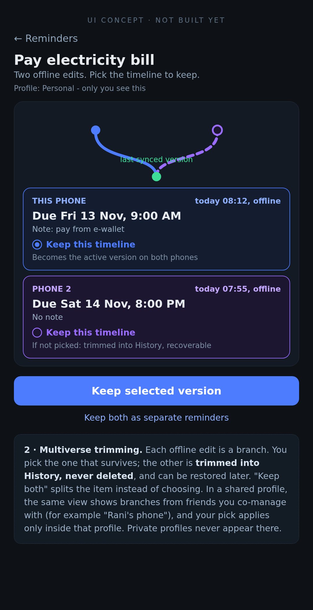
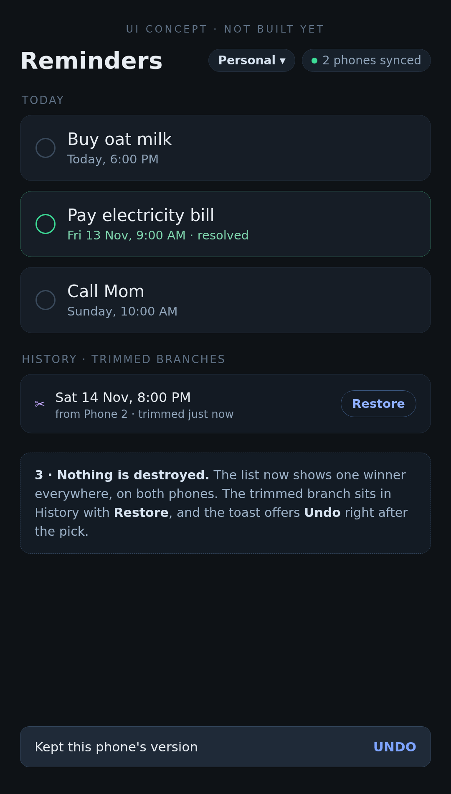

# Showing an edit conflict as branches: a UI idea for offline-synced lists

Status: idea only, from 2026-11-12. Not built, not user-tested, and no sync method or merge algorithm is claimed. Three illustrative concept screens are now included below; they are not functional screens.

## The problem
Two phones edit the same reminder while offline. When they sync, one edit can silently overwrite the other. This note relates to the local-first notes in this repo, which suggest showing a conflict as two versions to choose between.

## The idea ("trimming branches")
1. The item stays in the list with a "2 versions" badge and the line "both phones edited this offline". No pop-up, no lost edit. Tapping it opens the comparison.
2. The comparison shows a small branch diagram: the last synced version at the root, with one branch per phone, each showing its value, device and offline time. Before confirming, the screen says what will happen: the picked branch becomes the active version everywhere, and the other is trimmed into History, where it can be recovered. A second option keeps both as separate items when neither should win.
3. After the choice, one version is active everywhere, an Undo message appears, and a History section lists trimmed versions with a Restore button. Trimming is archiving, not deletion.
4. Profiles: in a list shared with other people, the same view shows their branches, and a pick applies only inside that list. Private lists never appear in a shared view.

## What it does not claim
No storage provider, network or merge method is chosen. Automatic merging of text edits, how conflicts are detected, and how a pick is written back to each device are open design questions. The idea was never tested with users.

## Concept screens

All three images are illustrative concept screens rendered 12 Nov 2026. Every reminder, device and name shown is invented; these are not records of real people or reminders.

*Screen 1: the badge. The item stays in place; a badge is the whole interruption.*

*Screen 2: the multiverse. Each branch says what happens before confirmation; keeping both splits the item instead of choosing.*

*Screen 3: nothing is destroyed. The trimmed branch is archived and recoverable.*
