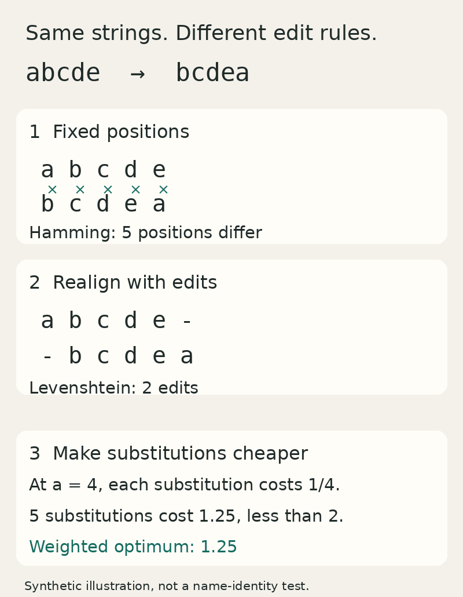

# Hamming, Levenshtein and the cost of a missing letter

Reading note, 21 Nov 2026. Selected text: **An Algorithmic Bridge Between Hamming and Levenshtein Distances**, Elazar Goldenberg, Tomasz Kociumaka, Robert Krauthgamer and Barna Saha, arXiv:2211.12496v1, 22 Nov 2022. [Read the selected PDF](https://export.arxiv.org/pdf/2211.12496v1.pdf). This note reads the complete 26-page v1, including its appendix. A conference counterpart appeared at ITCS 2023; this is not a survey of advances since 2022.

**The useful distinction:** Hamming counts different characters at fixed positions. Levenshtein can also insert and delete characters, so it can realign strings. The paper studies how the cost of those operations changes algorithmic complexity. It does not propose a personal-name matching system. A short-name sorting design for Simak is discussed separately below, with synthetic examples only. The paper's advanced algorithm has not been implemented as part of this reading note.

*Original explanatory illustration, computed synthetic string example, not a paper figure, app screenshot or measured name-matching result.*

## Three distances, three questions

| Measure | What counts as an edit? | What it tells us | Limit |
| --- | --- | --- | --- |
| Hamming | Substitute one character at a fixed position, cost 1 | How many positions differ? | Requires equal-length strings; it cannot realign after an insertion or deletion. |
| Unit-cost Levenshtein | Insert, delete or substitute one character, each cost 1 | Minimum number of edits to transform one string into another | Character order matters; a word-order change can look very distant. It is not identity confidence. |
| The paper's weighted ED_a | Insertion/deletion cost 1; substitution costs 1/a, for a at least 1 | How computation changes when substitutions are cheaper than insertions/deletions | The parameter encodes a chosen error model, not a learned likelihood of two people being the same. |

For `abcde` and `bcdea`, Hamming is **5**: every position differs. Unit-cost Levenshtein is **2**: delete the initial `a`, then insert `a` at the end. This is a sequence shift, not a special transposition operation.

At `a = 4`, substituting all five characters costs `5/4 = 1.25`, less than the two-indel alignment. The weighted optimum is therefore **1.25**, verified with a small exact dynamic program. These toy computations are not an implementation of the paper's fast algorithms.

A scaling detail matters. For sufficiently large `a` on equal-length strings, a substitution-only alignment is optimal and `ED_a = Hamming/a`. Thus `a × ED_a` equals Hamming in that regime. Unscaled `ED_a` tends to zero as substitutions become free; its numeric value does not tend to the ordinary Hamming count. At `a = 1`, ED_a is ordinary unit-cost Levenshtein.

## What the paper contributes

Let `n` be the total length of both strings, `k` a threshold/bound on weighted distance, and `epsilon` an approximation parameter. The stated algorithmic propositions use a positive integer a; the cost-model intuition allows a at least 1. The soft-O notation below hides polylogarithmic factors. Bounds are attributed to the selected v1, not reproduced proofs or measured performance.

| Contribution | Result in the paper | How to read it |
| --- | --- | --- |
| Deterministic exact algorithm | Proposition 1.1: `O(n + k min(n, ka))`, computing ED_a or reporting it exceeds k | An adaptation of diagonal/wavefront-style edit computation and longest-common-extension queries. For a=1 this gives `O(n + k min(n,k))`. |
| Conditional lower bound | Theorem 1.9 makes the exact bound essentially tight up to subpolynomial factors under the Orthogonal Vectors Conjecture, over the specified parameter range | A conditional theoretical barrier, not an unconditional claim that no faster method can ever exist. |
| Randomized approximation | Theorem 1.5: for constant epsilon and the relevant k>=1 regime, soft-`O(n/a + a k^3)` for the bounded `(1+epsilon)` gap problem | Sublinear in n only for suitable a and sufficiently small k. The full theorem includes epsilon dependence and separate k<1 and large-k cases. |
| Separate edit budgets | Theorem 1.6: a `(1,1+epsilon)` bicriteria result for at most k_I indels and roughly k_S substitutions; fixed-epsilon time soft-`O(n k_I/k_S + k_S k_I^3)` | Allows no multiplicative relaxation of the indel budget, while relaxing substitutions. Most relevant when indels are much fewer than substitutions and total distance is small enough. |
| Technical tool | Approximate longest-common-extension queries, randomized preprocessing and almost-periodic string structure | The engine behind their sublinear results, not a drop-in scoring formula for a contact list. |

The formal bounded approximation is a decision guarantee: YES when `ED_a <= k`, NO when `ED_a > (1+epsilon)k`, and either answer in between. The bicriteria version similarly distinguishes the original budgets from the relaxed substitution budget. It does not promise to resolve that gap exactly.

### Why the speed-up is possible

The paper assumes constant-time random access to input characters and known string lengths. It can probe selected positions rather than read every character. It uses sampling and approximate periodicity to answer extension queries efficiently, then feeds those answers into coarser-grained alignment computations. Correctness is with high probability for the randomized results.

That is different from reading names from storage, normalizing them and sorting every candidate in an application. The theorem does not make that end-to-end pipeline sublinear. A low theoretical bound also does not establish a practical speed-up for short strings: no short-name benchmark or phone battery result is presented here.

The authors motivate their substitution-heavy model partly with sequence-comparison applications such as computational biology. Their chosen cost ratio is not evidence that substitutions are cheaper than insertions for human names, nor a recommendation for a specific contact-matching weight.

## A separate practical proposal for Simak

This section is application design inspired by the distinction between metrics, **not a result of the paper and not a release/implementation claim**. Simak's implementation and qualification are tracked separately. No app code, eligibility threshold or stored contact data is changed by this note.

Keep two jobs separate:

1. **Eligibility:** which pairs are shown as possible name matches. Preserve existing accepted partial matches when changing only sorting.
2. **Ranking:** in what order those eligible pairs appear for a given speaker.

A reasonable design to evaluate is:

| Stage | Proposed behavior | Why not just use one edit-distance number? |
| --- | --- | --- |
| Name parsing | Separate real speakers; remove affiliations before comparing names, while retaining the full label for display | An organization or role is not part of a person's name. Punctuation inside an affiliation must not invent another speaker. |
| Exact tier | Full normalized string equality first, with an explicit case/punctuation/space policy | Transparent and stable. Normalization still needs tests; it does not prove identity. |
| Reordered-full-name tier | Same complete name-token multiset in a different order next | Raw Levenshtein can penalize harmless word-order changes severely. Use a multiset so duplicate words are not silently lost. |
| Partial tier | Evaluate normalized Levenshtein similarity alongside token overlap/coverage of both names | Character closeness and shared words answer different questions. A common-token-only match should not automatically beat a near-full-name match. |
| Stable ties | Alphabetical tie-break within each speaker's matches, then a deterministic secondary key if labels are identical | Contact-provider row order should not decide visible ranking. Do not expose private identifiers. |

One common illustrative normalization is `similarity = 1 - distance/max(length1,length2)`. Identical nonempty strings score 1. The both-empty case needs an explicit rule, and empty strings should not become accidental identity hints. This normalization is a design choice, **not the paper's ED_a or a calibrated probability**. No fixed edit/token blend weight is justified by this paper; choose one only after explicit synthetic acceptance cases and, if authorized, suitable evaluation data.

## Synthetic examples: why tiers matter

All names in this table are invented test strings, not contacts or speaker-contact mappings. Lowercase inputs include the single space as a character. Values were computed with exact unit-cost Levenshtein dynamic programming.

| Name A | Name B | Levenshtein | Illustrative similarity | Lesson |
| --- | --- | --- | --- | --- |
| mira sen | mira sen | 0 | 1.000 | Exact tier. |
| mira sen | sen mira | 8 | 0.000 | Same complete token multiset, reordered. Raw character distance alone misses this. |
| mira sen | mira seen | 1 | 0.889 | One inserted letter; Hamming is undefined because lengths differ. |
| mira sen | mira | 4 | 0.500 | Partial name, not a full match. Preserve eligibility separately from order. |
| mira sen | mira tan | 2 | 0.750 | Good character similarity is still not evidence of the same person. |

Token overlap also has choices: set versus multiset, coverage of the shorter name versus both names, handling initials and repeated words. Accents, Unicode normalization, nicknames, transliteration and titles require an explicit policy rather than accidental behavior. Stripping punctuation is not universally harmless. No single score can remove these ambiguities.

## What this note does not establish

- No implementation, integration, speed benchmark, production ranking quality or battery saving is claimed.
- No contact names, screenshots, private mappings or device logs were used in the published examples.
- No fuzzy-match threshold is tightened or partial match removed by this note.
- A high string-similarity score is not a probability, identity proof or permission to merge contacts.
- The v1 proofs were read, not formally verified or independently rederived. Their 2022 statements about prior state of the art are not presented as current 2026 facts.

For a short-name UI, start with a simple exact distance implementation and readable deterministic tiers, then test the result. The research paper matters because it shows how changing the error model changes both the distance and its computational difficulty, not because its most advanced algorithm must be used in a small contact list.

## Sources and reading map

- [Selected arXiv v1 PDF, 22 Nov 2022](https://export.arxiv.org/pdf/2211.12496v1.pdf): abstract and Section 1 for motivation and statements; Sections 2-3 for exact/approximate ED_a; Section 4 for approximate extension queries; Section 5 for the conditional lower bound; Appendix A for bicriteria algorithms.
- [arXiv record](https://arxiv.org/abs/2211.12496): authors and version/publication context.
- [ITCS 2023 publication record](https://drops.dagstuhl.de/entities/document/10.4230/LIPIcs.ITCS.2023.58): conference counterpart, DOI `10.4230/LIPIcs.ITCS.2023.58`. This reading remains pinned to the selected v1.
- [NIST: Hamming distance](https://xlinux.nist.gov/dads/HTML/HammingDistance.html) and [NIST: Levenshtein distance](https://xlinux.nist.gov/dads/HTML/Levenshtein.html): supplementary definitions.

- [Unicode Standard Annex #15: Unicode Normalization Forms](https://www.unicode.org/reports/tr15/): supplementary background for the application-design caution about normalization, not a human-name matching policy.
