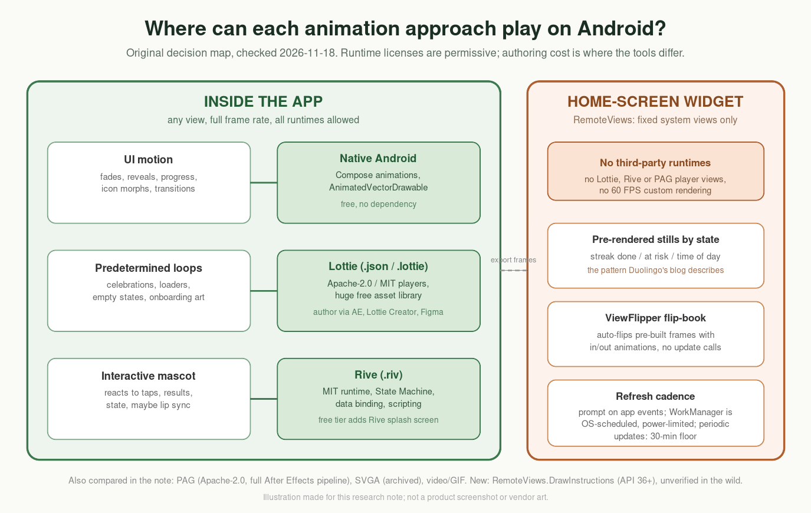

# Lottie vs Rive and other animation options for Android (in-app and home-screen widget)

Facts checked 2026-11-18 against the official pages linked at the end. Prices, free-tier limits and platform rules change without notice; the check date is part of the content. Vendor comparisons are labeled as vendor claims. This note is general research, not a commitment to any tool for any specific app.

## Short answer

For an Android app that wants an animated mascot plus a home-screen streak widget, the choice splits in two, because a widget cannot host any of the third-party animation runtimes:

- **In the app:** all of Lottie, Rive and PAG are realistic options with permissive open-source runtimes (Apache 2.0 or MIT, no runtime fees). Rive is the stronger fit for an *interactive* character that reacts to taps, results and state (its State Machine is exactly what Duolingo uses for character lip sync). Lottie is the stronger fit for *predetermined* loops (celebrations, loaders, empty states), with a larger ecosystem of ready-made files and authoring routes.
- **On the home-screen widget:** no Lottie, Rive or PAG player can run there, because widget layouts are `RemoteViews`, restricted to a fixed list of system views. That does not mean widgets cannot animate at all. Bounded, platform-native animation exists: `ViewFlipper` (whitelisted for widgets) can auto-flip between child views with in/out transition animations, an indeterminate `ProgressBar` animates itself, and `Chronometer`/`TextClock` tick. Newer still, Android (API 36) added `RemoteViews.DrawInstructions`, a bridge to RemoteCompose that carries recorded draw instructions rendered in the host process. What widgets cannot do is 60 FPS custom-rendered playback driven by your own view or runtime. The mainstream pattern, and the one Duolingo's own widget blog describes, is pre-rendered still images that change with state; a short flip-book effect via `ViewFlipper` is a documented option on top of that.

*Illustration: original decision map made for this note, not a product screenshot or vendor art. [Editable SVG](assets/animation-comparison/animation-decision-map.svg).*

## What Duolingo actually uses

A common assumption is that Duolingo "uses Lottie or something." Verified from both sides:

- **Lottie:** Duolingo's team writes on the LottieFiles case study that it has integrated "thousands of files" through LottieFiles tooling, and credits Lottie with keeping file sizes small across devices.
- **Rive:** Duolingo's engineering blog describes using Rive and its State Machine to lip-sync its World Characters, mapping speech-recognition phoneme timings onto viseme mouth states, reacting in real time (tap a word, the character says it; finish early, it stops).
- **Widget:** Duolingo's widget blog post describes its home-screen widget as a series of illustrations of the owl whose mood changes with time of day and whether the day's lesson is done, next to a streak counter. An independent write-up describes the same behavior. This establishes Duolingo's design choice of changing stills; it does not by itself prove anything about what the platform can or cannot animate — that comes from the Android documentation below.

So the honest answer is "both, for different jobs" — and the widget is a third technique entirely.

## The options, compared

| | Lottie (JSON / .lottie) | Rive (.riv) | PAG (.pag) | Native Android (Compose, AnimatedVectorDrawable, AnimationDrawable) | Video / GIF / image sequence |
|---|---|---|---|---|---|
| Best at | Predetermined vector loops: celebrations, loaders, onboarding art | Interactive characters and controls: state machines, data binding, scripting | Full After Effects feature set, including raster effects; runtime text/image swap (video templates) | UI motion: fades, scales, reveals, icon morphs | Cinematic or photorealistic clips |
| Interactivity | Limited: playback control, theming; dotLottie adds click/hover state machines | Core design: State Machine, inputs, events, Data Binding to live data, AnimaScript/Luau scripting | Runtime replace text/images/layers, combine compositions | Fully code-driven, state-aware | None (playback only) |
| Android runtime license | Apache 2.0 (`lottie-android`, ~35.7k stars); dotLottie player MIT (ThorVG core) | MIT (`rive-android`, min SDK 21) | Apache 2.0 (`libpag`, Android 5.0+) | Platform APIs, no dependency | Platform APIs |
| Authoring | After Effects + free Bodymovin exporter (MIT, in `lottie-web`); or browser-based Lottie Creator / Figma plugins via LottieFiles | Rive Editor (proprietary, browser/desktop) or Rive CLI driven by a coding agent | After Effects + free PAGExporter plugin (macOS/Windows), preview in PAGViewer | XML / Kotlin in Android Studio | Any video tool |
| Authoring cost | AE: Adobe's official product page states "plans starting at US$22.99/mo" (captured from adobe.com via search excerpt; the live pricing table is JS-rendered and did not render in a text fetch). LottieFiles: free Starter plan (5 private uploads + 5 public downloads, lifetime, 20 MB), Individual $19.99/user/mo non-commercial, Team $24.99/user/mo for commercial use of its services. Free public-library animations are commercially usable on any plan under the Lottie Simple License. | Free plan: editor + CLI, but exported .riv files play a short Rive splash screen; Cadet $9/seat/mo removes it (max 3 seats); Voyager $32; organizations above $10M annual gross revenue must use Enterprise per Rive's terms. CLI work by a coding agent locally is free and unlimited; only publishing/pushing counts against a monthly allowance. | AE as above; exporter and viewer free | Free | Varies |
| File size (vendor-reported) | JSON is verbose; dotLottie zips animations+assets and LottieFiles claims optimized exports cut size up to 80% | Rive claims 10–15x smaller than equivalent Lottie JSON; reports Duolingo at 15x and CARS24 cutting ~150KB to ~15KB | PAG claims ~50% smaller than JSON for the same animation, ~10x faster decode | Smallest possible for simple motion | Largest |
| Platform reach | Web, Android, iOS, React Native, Flutter, Windows; dotLottie players share one rendering core | Web, Android, iOS, Flutter, React Native, Unity, Unreal, C++, cars/TVs/consoles | Android, iOS, Web, macOS, Windows, Linux, OpenHarmony | Android only (separate iOS work) | Everywhere |

One more format: **SVGA** (SVGAPlayer) is a Lottie-like After Effects/Animate CC player for Android/iOS/Web, Apache 2.0, but its Android repo is archived and unmaintained. Listed for completeness; not a good starting point.

## Performance evidence

- An independent 2023 benchmark (Callstack, React Native, old Sony Xperia) measured the same animation at roughly 17 FPS in Lottie vs 60 FPS in Rive, with total memory use in the same range (246 MB vs 276 MB). Caveats: React Native context, 2023, one sample animation derived from a vendor demo. Directionally consistent with vendor claims, not definitive for native Android today.
- Rive's own comparison (vendor, updated October 2026) emphasizes GPU rendering through its own renderer, smaller binary files, and notes Lottie offload to the OS render server can hide CPU cost in profiling.
- For simple UI motion, native Compose animation APIs (`AnimatedVisibility`, `AnimatedContent`, `animate*AsState`, `Transition`, `InfiniteTransition`) and drawable animations (`AnimatedVectorDrawable` for vector morphs, `AnimationDrawable` for frame sequences) avoid any third-party runtime entirely and are the documented default for state-driven UI.

## What a home-screen widget can and cannot do

Verified from Android documentation, with community evidence labeled as such:

**Cannot: host third-party or custom-rendered animation views.** A widget layout is a `RemoteViews`, restricted to a fixed set of layouts (`FrameLayout`, `LinearLayout`, `RelativeLayout`, `GridLayout`, `AdapterViewFlipper`, `StackView`, `ListView`, `GridView`, `ViewFlipper`) and widgets (`AnalogClock`, `Button`, `Chronometer`, `ImageButton`, `ImageView`, `ProgressBar`, `TextClock`, `TextView`, plus `CheckBox`/`RadioButton`/`RadioGroup`/`Switch` from API 31). Custom views and subclasses are not supported, so no Lottie, Rive or PAG player view can exist in a widget. Widgets also run in the launcher process under a per-widget bitmap memory ceiling, and only touch and vertical-swipe gestures are available.

**Can: bounded, platform-native animation.**

1. **`ViewFlipper` / `AdapterViewFlipper` transitions.** Both flippers are on the `RemoteViews` whitelist. The official `ViewFlipper` documentation describes it as animating between child views, with `android:autoStart`, `android:flipInterval` and `android:inAnimation`/`android:outAnimation` attributes, so a widget can cycle through pre-built child views with fade/slide transitions on a timer, without any app update calls. A community answer shows exactly this XML working in a widget (StackOverflow, old but specific; not re-tested here). This is the documented route to a flip-book mascot on the home screen, bounded to swapping among pre-built frames rather than free-form rendering.
2. **Self-animating system widgets.** An indeterminate `ProgressBar` animates itself in a widget without updates, and `Chronometer`/`TextClock` tick (community evidence for the ProgressBar behavior; the views themselves are on the whitelist).
3. **`RemoteViews.DrawInstructions` (API 36+).** The `RemoteViews` reference documents carrying recorded draw instructions rendered in the host process, as an alternative to XML layout, with a 21 MB payload cap and mixing restrictions. Android's Dev Summit talk on RemoteCompose says the RemoteViews implementation of RemoteCompose has shipped in the platform since API 36. This is the newest route to richer custom widget rendering; real-world launcher support and animation capability are unverified here.
4. **Frame-swaps via update calls.** Technically possible, but every update is inter-process communication to the launcher, so fast frame animation this way is expensive; long-standing community guidance (CommonsWare) is to not animate widgets by rapid updates.

**Refresh cadence: the 30-minute floor applies to one mechanism only.** `updatePeriodMillis` (the scheduled periodic update) is not delivered more than once every 30 minutes, and can be set to 0 to disable periodic updates entirely. That floor does not govern the other refresh mechanisms: the advanced-widget documentation describes full and partial updates and collection refreshes that the app can trigger in response to user interaction or broadcast events, and scheduled work via `WorkManager` (with its own power restrictions). So a widget can refresh promptly when the owning app completes a lesson, while passive timed refreshes stay slow by design.

## Practical consequences for a mascot streak widget

1. Pre-render mascot poses/states as bitmaps (or export frames from the same Lottie/Rive source art) and swap `ImageView` content on state changes: streak done, at risk, broken, time-of-day mood. This is the pattern Duolingo's blog describes.
2. A short looping flip-book (a few frames of the mascot blinking or waving) is achievable with `ViewFlipper` auto-flip and transition animations, without update calls; whether it behaves well across launchers is untested here and belongs on the prototype list.
3. Event-driven updates (lesson completed, streak extended) come straight from the app; passive daily mood changes use `WorkManager` or the 30-minute-plus periodic update.
4. The streak count itself is a `TextView`; tapping the widget opens the app (`PendingIntent`).

## Recommendation sketch for a mascot + streak-widget app (proposal, not settled)

1. **In-app mascot:** Rive if the character should react — tap responses, lesson-result reactions, idle behaviors, maybe lip sync later. The State Machine keeps that logic in the asset instead of app code, and the free plan plus local CLI building covers an agent-driven workflow at zero cost, with one real catch: free exports carry a Rive splash screen, so shipping without it needs the $9/seat Cadet plan. Lottie is the fallback if the mascot only plays predetermined loops: no splash screen, a huge free asset library, and several free authoring routes (Lottie Creator, Figma plugins, or After Effects + Bodymovin if AE is already paid for).
2. **UI motion (progress, transitions, icon feedback):** native Compose/drawable APIs, no runtime dependency.
3. **Widget:** pre-rendered mascot stills by streak state and time of day, exported from the same source art as the in-app mascot; event-driven updates after lessons; optionally a bounded `ViewFlipper` flip-book if prototyping shows it is reliable across launchers.
4. Nothing here requires PAG; it becomes interesting only if the authoring pipeline is already After Effects with heavy raster effects.

## Unverified / open

- The 2023 FPS benchmark predates current runtimes and was on React Native; treat native-Android performance of current Lottie vs Rive as untested here. A small prototype rendering the same mascot in both would settle it.
- Rive's free-plan splash screen behavior (duration, placement) is described on its pricing page but was not tested in a build.
- Adobe's price is from the official product page's own text as captured by search ("plans starting at US$22.99/mo"); the full live pricing table is JS-rendered and was not fetched as page text. Regional pricing for Indonesia was not checked.
- `ViewFlipper` auto-flip behavior inside widgets across current launchers and Android versions: documented attributes plus an old community confirmation, not re-tested.
- `RemoteViews.DrawInstructions` / RemoteCompose (API 36+): documented, but animation capability and launcher support in the wild are unverified.
- LottieFiles' Starter plan forbids commercial use of its *services*; the boundary between "used the free editor" and "used free public animations" matters and should be re-read at shipping time.

## Sources

Checked 2026-11-18.

Official:

- Rive pricing — https://rive.app/pricing
- Rive vs Lottie (Rive's own comparison, updated October 2026) — https://rive.app/blog/rive-as-a-lottie-alternative
- rive-android runtime (MIT) — https://github.com/rive-app/rive-android
- lottie-android (Apache 2.0) — https://github.com/airbnb/lottie-android
- lottie-web / Bodymovin (MIT) — https://github.com/airbnb/lottie-web
- dotLottie format — https://dotlottie.io/
- dotlottie-android player (MIT) — https://github.com/LottieFiles/dotlottie-android
- LottieFiles pricing — https://lottiefiles.com/pricing
- LottieFiles Starter-plan limits — https://help.lottiefiles.com/hc/en-us/articles/16240626895385-file-upload-and-download-limits-on-free-workspace
- LottieFiles plan guidance and commercial-use boundary — https://help.lottiefiles.com/choosing-the-right-plan-for-you
- Tencent libpag (Apache 2.0) — https://github.com/Tencent/libpag and its LICENSE.txt
- SVGAPlayer-Android (archived) — https://github.com/svga/SVGAPlayer-Android
- Android: RemoteViews reference (whitelist, DrawInstructions) — https://developer.android.com/reference/android/widget/RemoteViews
- Android: ViewFlipper reference (autoStart, flipInterval, in/out animations) — https://developer.android.com/reference/android/widget/ViewFlipper
- Android: AppWidgetProviderInfo (30-minute floor on scheduled updates) — https://developer.android.com/reference/android/appwidget/AppWidgetProviderInfo
- Android: Create a basic widget — https://developer.android.com/develop/ui/views/appwidgets
- Android: Create an advanced widget (update types, event-driven updates, WorkManager) — https://developer.android.com/develop/ui/views/appwidgets/advanced
- Android: App widgets overview — https://developer.android.com/develop/ui/views/appwidgets/overview
- Android: Animate drawable graphics — https://developer.android.com/develop/ui/views/animations/drawable-animation
- Android: Animations in Compose — https://developer.android.com/develop/ui/compose/animation/introduction
- Android Dev Summit: Powering interactive surfaces with Remote Compose (RemoteViews implementation shipping since API 36) — https://developer.android.com/events/dev-summit/talks/powering-interactive-surfaces-with-remote-compose.txt
- Duolingo: World Character visemes with Rive — https://blog.duolingo.com/world-character-visemes/
- Duolingo: widget design — https://blog.duolingo.com/widget-feature/
- LottieFiles: Duolingo case study — https://lottiefiles.com/case-studies/duolingo
- Adobe After Effects — https://www.adobe.com/products/aftereffects.html

Independent / community:

- Callstack: Lottie vs Rive benchmark (2023) — https://www.callstack.com/blog/lottie-vs-rive-optimizing-mobile-app-animation
- sekin.in: mobile animation decision guide (2026) — https://sekin.in/how-to-create-mobile-app-animations-for-android-and-ios/
- duoplanet: Duolingo widget write-up — https://duoplanet.com/duolingo-widget/
- StackOverflow: "Is there a way to animate on a Home Widget?" (2010-2012 answers: ViewFlipper XML sample, indeterminate ProgressBar, guidance against rapid updates) — https://stackoverflow.com/questions/2565023/is-there-a-way-to-animate-on-a-home-widget
