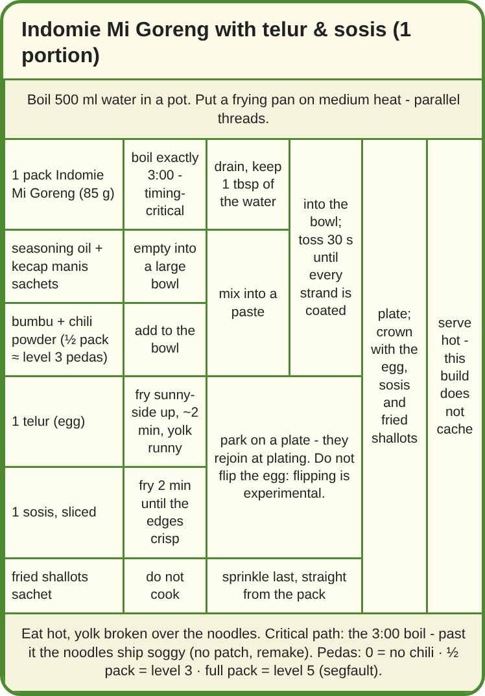

# Standalone authored examples

The [customizable Indomie Tangle recipe box](https://vanipy.com/kaji/indomie/) is the main interactive recipe page. Its source is in `indomie/index.html`, with vendored libraries in `indomie/tangle/lib/`. The previous engineering spec remains available at [vanipy.com/kaji/indomie/instinct/](https://vanipy.com/kaji/indomie/instinct/). Other entries in this directory are standalone source examples, not deployed services.

- **Indomie Mi Goreng recipe-box card (primary tabular version):**

  

  [Open the full-size recipe-box card](indomie/images/indomie-recipe-box-v2.jpg). This is the user-selected left-to-right version: one portion with telur and sosis; parallel cooking threads merge at plating, with the 3:00 boil as the critical path.

- [Kaji cook: more customizable recipe boxes](cook/index.html) - [open the live collection](https://vanipy.com/kaji/cook/). Nasi goreng, spaghetti aglio e olio and tumis kangkung in the same parallel-thread, merged-cell format as the Indomie box, with adjustable portions and options. The recipes are not kitchen-tested; each page lists its food-safety notes and sources. Shared code is in `cook/cook.js`; the Tangle library is reused from `indomie/tangle/lib/`.
- [Synthetic break-even chart adaptation](economics-synthetic/) - [open the explanatory page](https://vanipy.com/kaji/economics-synthetic/). It uses invented sales scenarios based on the already-public hypothetical worked example; it is not the original private-valued chart set. Inputs and caveats are in its README, CSV, and page footer.
- [Customizable Indomie recipe box (Tangle)](indomie/index.html) - [open the live main recipe page](https://vanipy.com/kaji/indomie/), based on the 500 ml tabular card. The card, this Tangle version, and the separate engineering spec are distinct versions; do not treat them as one reconciled recipe.
- [Indomie Goreng: an engineer's spec](indomie/instinct/index.html) - [open the live archived version](https://vanipy.com/kaji/indomie/instinct/). It uses 400 ml water, drains fully, and defaults spice to level 2, while the card uses 500 ml, reserves 1 tablespoon of water, and specifies half a chili-powder pack (about level 3). Do not treat the variants as one reconciled recipe. Its reference food photo is credited to Gunawan Kartapranata under CC BY-SA 3.0, with the source link on the page.
- [Tumbuh's first page (draft)](tumbuh/index.html) - an archived workshop concept, not an active offer. Signup controls are disabled; there is no payment, signup or contact collection.
- [Multiverse trimming conflict concept](conflict/index.html) - illustrative concept screens, not built UI. All items and names shown are invented.
