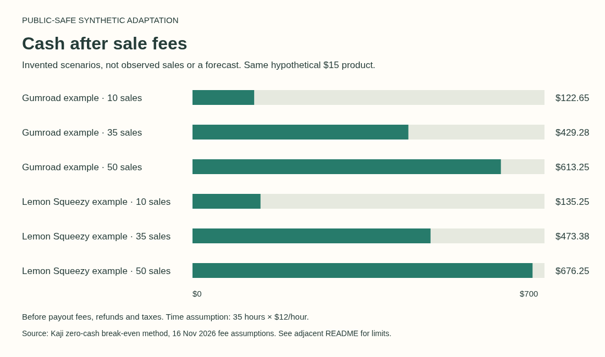
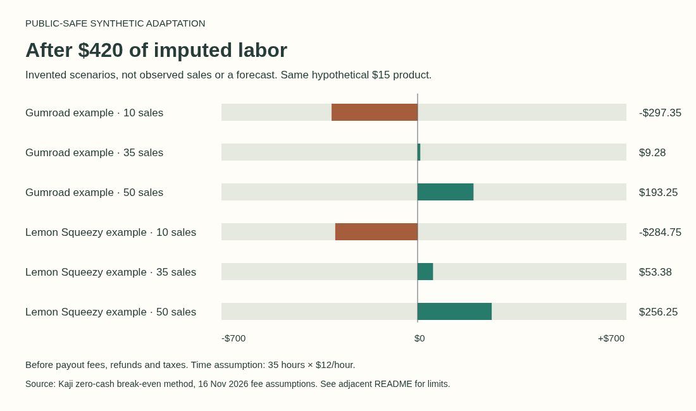

# Synthetic economics chart adaptation

Open index.html in any browser. No build step or network dependency. Two charts use the already-public hypothetical worked example in docs/zero-cash-break-even.md. The original private-valued six-model charts are not included; this is a distinctly labeled adaptation with different inputs and scope. scenario-data.csv contains the plotted arithmetic.

SVG versions remain editable. Both charts are adaptations, not the original private-valued business-model comparisons. Formula, input table, omissions and historical fee-check date are in index.html and scenario-data.csv.
