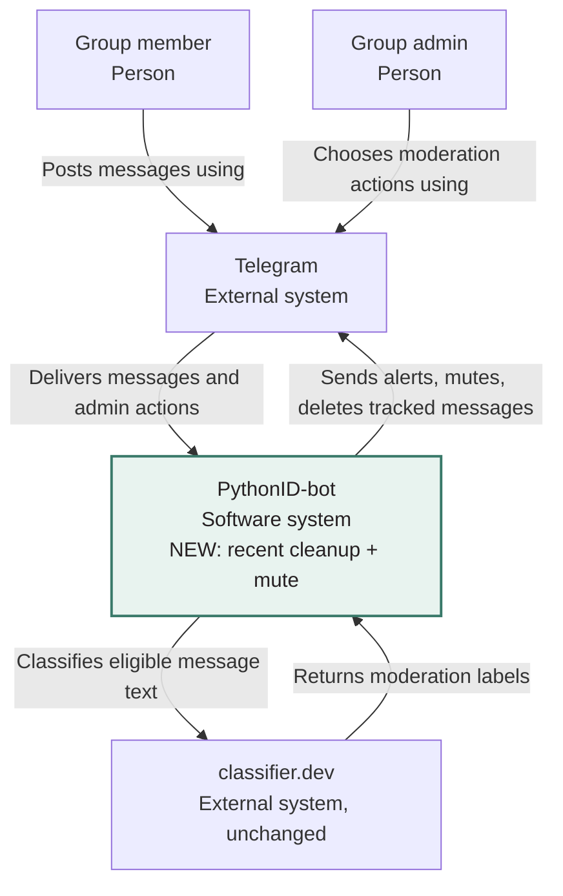
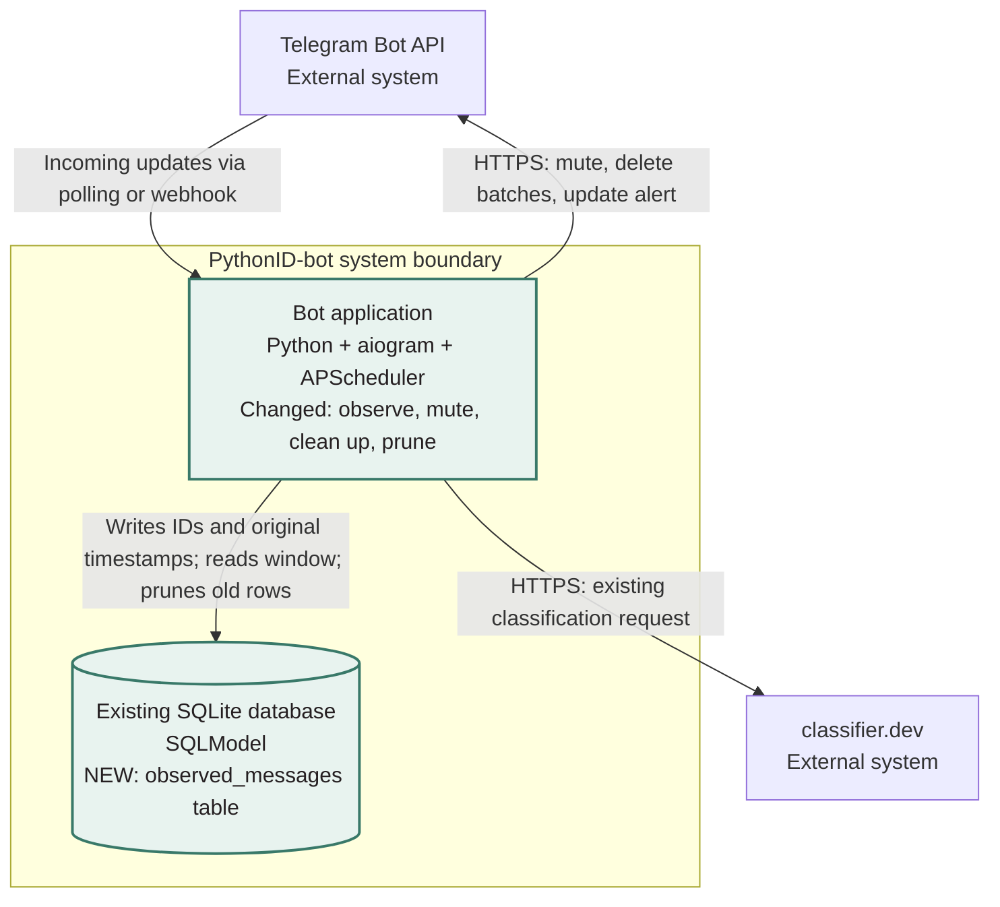
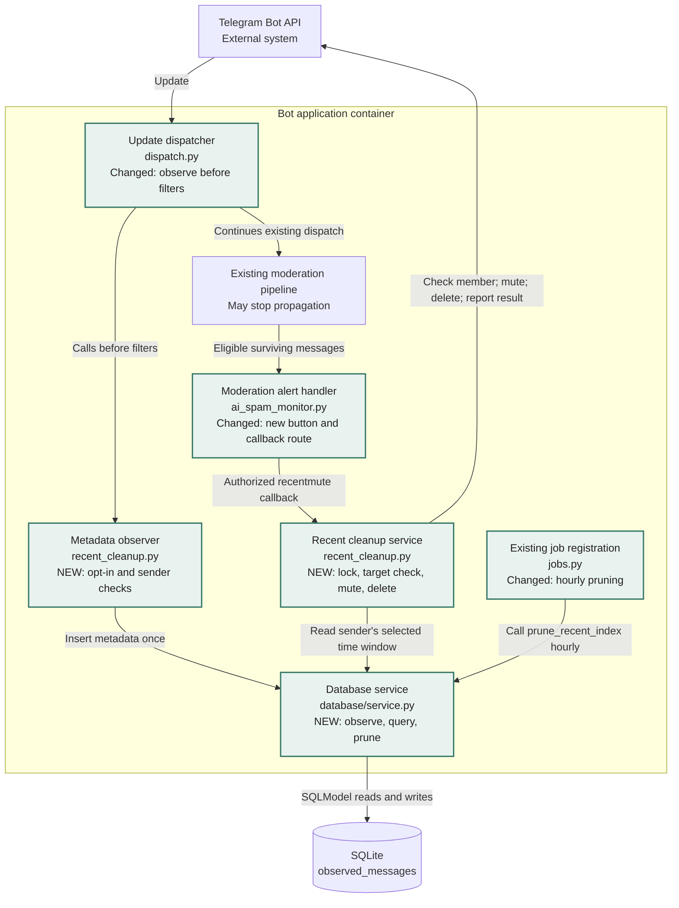
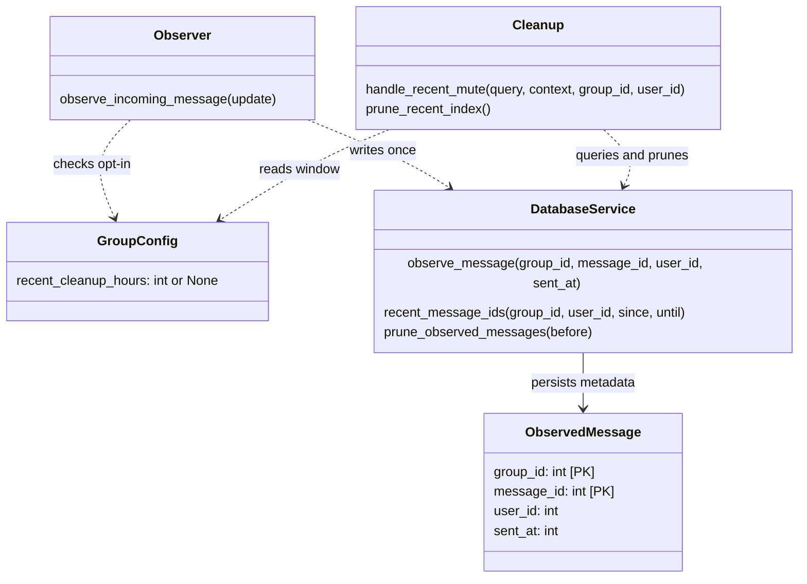

# Recent cleanup: four levels of detail

Architecture notes for PR #60, based on head `a08f6f6`. These diagrams describe
the proposed code, not a deployed feature. In levels 1-3, teal boxes identify new or
changed parts; other boxes provide existing context. Arrows name interactions,
not deployment boundaries. C4 containers mean applications or data stores,
not necessarily Docker containers.

## 1. System context: who uses it?

Members post through Telegram. An admin receives a moderation alert and chooses
an action. The new action mutes a member and removes only recent messages the
bot has tracked. The separate existing ban still removes all that user's messages.

The member stays in the group and can read it. This is not a ban and cannot
retrieve messages from old group history.

## 2. Containers: what runs and what is stored?

One existing Python application handles updates, moderation and scheduled work.
The PR adds a metadata table to its existing SQLite database, not a new service.

Only group ID, message ID, sender ID and original sent-at timestamp are stored.
`recent_cleanup_hours` is opt-in, from 1 to 24 hours. An hourly job prunes rows
older than 24 hours. This is a rolling retention target, not deletion at the exact
24-hour instant; pruning depends on the scheduler running.

## 3. Components: where does the change fit?

Observation happens before moderation filters, including handlers that stop
later processing. The alert's existing group-admin check remains the entry gate
for the new action.

The job node summarizes the call through `prune_recent_index()` to the database
service. Classification is omitted here because it does not change.

## 4. Code: the metadata contract

This level focuses on the new index, where boundaries matter most: group,
sender, message identity and original date. Runtime order is described next,
rather than presenting a sequence diagram as a C4 code diagram.
Observer and Cleanup are function groups in `recent_cleanup.py`, not new Python
classes; the other three boxes name actual classes.

The primary key is `(group_id, message_id)`. Duplicate updates and edits do not
replace the original sender or timestamp. Queries filter by group, sender and
inclusive original sent-at window. Anonymous/on-behalf-of-chat messages and bot
senders are excluded.

### Action order and failure limits

1. Existing alert callback checks the caller is an admin of that group.
2. New handler rechecks opt-in, takes the group/member lock and checks its
   in-memory completed-alert set.
3. Telegram checks establish that this is a supergroup and the target is an
   active non-admin, non-bot member. The code selects tracked IDs in the window.
4. Mute first. If setup or mute fails, delete nothing and report the failure.
5. Delete selected IDs in batches of at most 100, with a one-second gap. Allow
   one retry for a flood wait of at most 30 seconds. Stop cleanup after an hour.
6. Report tracked and unconfirmed IDs, not a claimed count of actual deletions.
   Telegram skips IDs that are already missing.

No historical backfill or durable cleanup queue is added. A restart can leave
partial cleanup and the mute in place. Coverage can be incomplete after downtime
or when tracking has just been enabled. Existing profile/captcha/admin
unrestriction flows can later lift the mute; this is not a separate permanent
moderation hold. The existing full-history ban action is unchanged.

## References

- [C4 diagram levels](https://c4model.com/diagrams)
- [System context](https://c4model.com/diagrams/system-context)
- [Containers](https://c4model.com/diagrams/container)
- [Components](https://c4model.com/diagrams/component)
- [Code](https://c4model.com/diagrams/code)
- [Telegram message fields](https://core.telegram.org/bots/api#message)
- [Telegram ban behavior](https://core.telegram.org/bots/api#banchatmember)
- [Telegram deletion limits](https://core.telegram.org/bots/api#deletemessages)

---

Built with AI assistance (Instinct). Not everything has been reviewed by Irvan.
